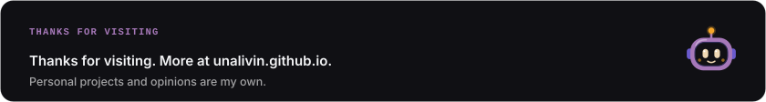

<!-- Generated by scripts/render.py. Edit profile.json or the script, not this file. -->

<a href="https://unalivin.github.io/"><picture></picture></a>

<a href="mailto:unalivin@proton.me"><picture></picture></a>
<a href="https://unalivin.github.io/"><picture></picture></a>
<a href="https://github.com/unalivin"><picture></picture></a>
<a href="https://x.com/unalivinx"><picture></picture></a>
<a href="https://instagram.com/unalivinx"><picture></picture></a>
<a href="https://leetcode.com/u/unalivinx/"><picture></picture></a>

<picture><source media="(prefers-color-scheme: light)" srcset="assets/svg/header-experience-light.svg" /><source media="(prefers-color-scheme: dark)" srcset="assets/svg/header-experience-dark.svg" /></picture>

<picture></picture>

<picture><source media="(prefers-color-scheme: light)" srcset="assets/svg/header-stack-light.svg" /><source media="(prefers-color-scheme: dark)" srcset="assets/svg/header-stack-dark.svg" /></picture>

<picture></picture>

<picture><source media="(prefers-color-scheme: light)" srcset="assets/svg/header-stats-light.svg" /><source media="(prefers-color-scheme: dark)" srcset="assets/svg/header-stats-dark.svg" /></picture>

<a href="https://github.com/unalivin"><picture></picture></a>

<a href="https://leetcode.com/u/unalivinx/"><picture></picture></a>

<a href="https://unalivin.github.io/"><picture></picture></a>

Profile design adapted from <a href="https://github.com/Sagargupta16">Sagargupta16</a> (MIT).

